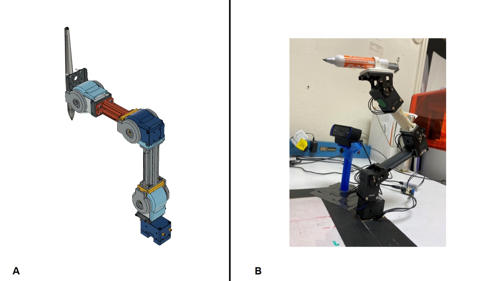
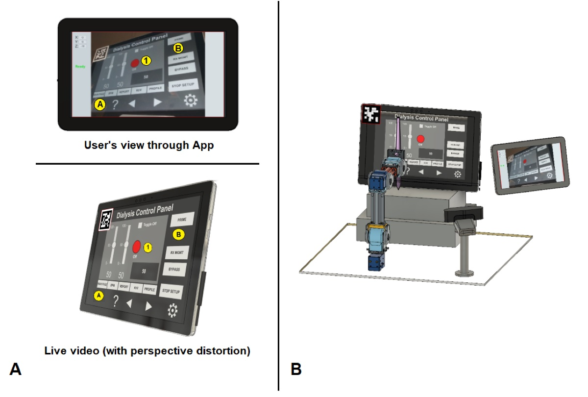
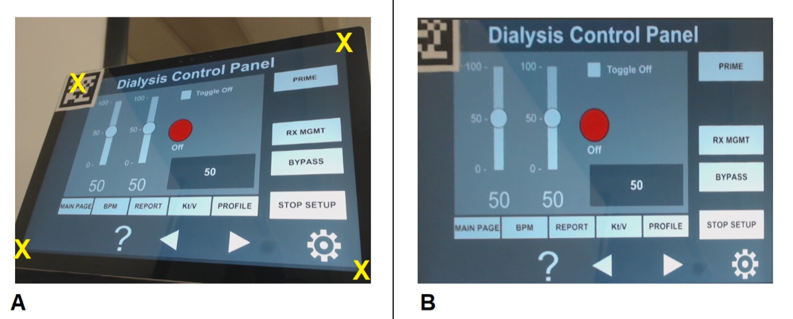

* Built a 4-DoF stylus robot (modified OpenManipulator-X, Dynamixel servos, Raspberry Pi 4) and the complete ROS integration for a non-invasive, retrofit approach to operating a dialysis machine's touchscreen remotely.
* Developed the computer-vision pipeline: camera calibration, a single ArUco marker, and homography mapping from a tap on the remote video to a robot target, plus a one-time camera-to-robot calibration.
* Proof of concept on a mock-up instrument panel: 100% successful button presses with ≤ 2.6 mm end-to-end error; operated from about 1.5 miles away. A 33-participant study (including 4 medical professionals) compared tablet touch and remote mouse click.

**Publication:** [A COVID-19 Emergency Response for Remote Control of a Dialysis Machine with Mobile HRI](/publication/2021-covid-dialysis-mobile-hri), *Frontiers in Robotics and AI*, 2021 (open access).

**My role:** main contributor to the robot, computer vision, and the entire ROS integration. Hassam Khan Wazir led the mobile app and the mock-up instrument panel, and Sonia Mary Chacko designed and analyzed the user studies.

Video
===

<iframe style="position:absolute;inset:0;width:100%;height:100%;border:0;" src="https://www.youtube-nocookie.com/embed/X3xGDrRx9pg" title="A COVID-19 Emergency Response for Remote Control of a Dialysis Machine with Mobile HRI" loading="lazy" allow="accelerometer; autoplay; clipboard-write; encrypted-media; gyroscope; picture-in-picture; web-share" referrerpolicy="strict-origin-when-cross-origin" allowfullscreen></iframe>

Why?
===

During the pandemic, healthcare workers had to enter patients' rooms to operate dialysis machines through their touchscreen control panels, increasing their exposure. This project explored an emergency response that requires no modification to the medical device: a small robot presses the touchscreen, while a remote operator watches a live video of the panel and taps where they want the robot to press.

System
===

**Robot.** A modified Robotis OpenManipulator-X with four degrees of freedom, driven by Dynamixel XL430 servomotors, with 3D-printed links and a stylus held by a pen-holder end effector. It runs ROS Melodic on a Raspberry Pi 4. The robot's workspace was analyzed with Denavit–Hartenberg forward kinematics and Monte Carlo sampling to define where the panel can be placed (0.20–0.27 m from the robot).

**Vision: from a tap to a robot target.**
* A calibrated webcam streams the panel to the operator's app as a ROS topic.
* A single 40 mm ArUco marker at the corner of the panel defines its plane; a homography maps the tapped pixel to a point on the panel.
* A one-time calibration estimates the camera pose in the robot frame, so each mapped point becomes a robot target. The robot moves above the point, presses until contact, and returns home.
* A ROS WebSocket server on the Raspberry Pi bridges the robot and the Unity app over Wi-Fi.

Results
===

**Bench tests** (proof of concept on a Surface Pro 4 running a mock-up of a Gambro X-36 dialysis machine's touchscreen panel):

| Measure | Result |
|---|---|
| Robot accuracy (5 points, 50 repetitions each) | 0.06–1.00 mm |
| Robot repeatability | 0.88–1.76 mm |
| End-to-end selection error (tap to press) | ≤ 2.56 mm |
| Button presses (8.6 mm buttons, 5 locations × 50 trials) | 100% successful |
| Command cycle time, operator about 1.5 miles away | ≈ 12.6 s |

**User study** (33 participants recruited, 30 analyzed, including 4 medical professionals): in-person touch on an Android tablet vs. remote mouse click on a computer.

* **No significant difference in task load** (NASA RTLX) between the two modes.
* **Usability (SUS):** the only significant difference was on the consistency item, in favor of click.
* **Frustration** was the highest-rated workload factor in both groups, attributed to the robot's speed and the "Busy" wait between commands. Skewed camera views were also criticized, which motivated a perspective-correction method proposed in the paper: the user marks the panel's four corners, and the app shows a rectified view while mapping taps back to the camera image.

Figures adapted from Wazir, Lourido, Chacko &amp; Kapila, <i>Frontiers in Robotics and AI</i> 8, 612855 (2021), <a href="https://doi.org/10.3389/frobt.2021.612855">doi:10.3389/frobt.2021.612855</a>, licensed under <a href="https://creativecommons.org/licenses/by/4.0/">CC BY 4.0</a>.

