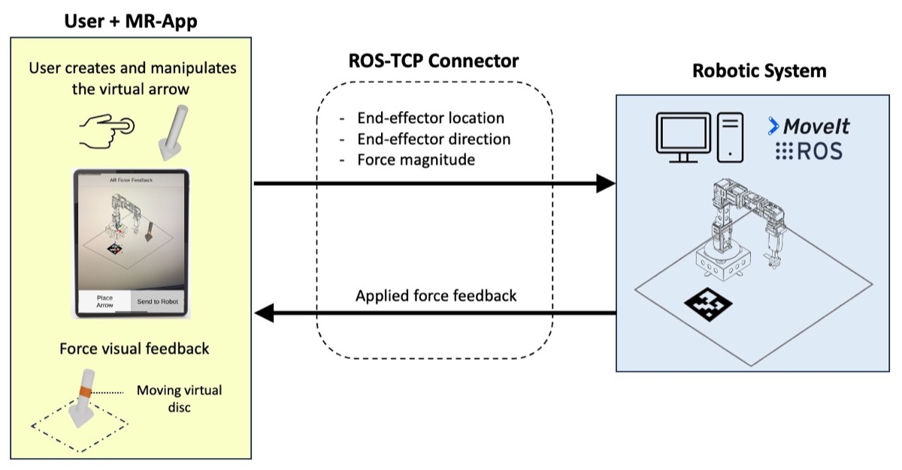
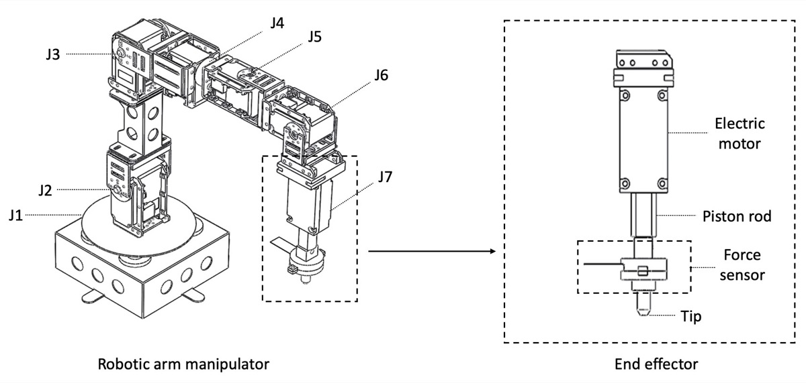
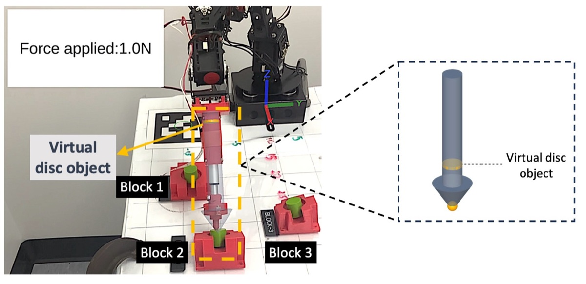

* Built a custom 7-DoF robot (six Dynamixel revolute joints and a linear-actuator end effector with a FlexiForce force sensor driven by an Arduino) and its ROS / MoveIt stack, from URDF model to force-controlled execution.
* Developed a Unity / AR Foundation (ARKit) mixed-reality app for iPad Pro in which a virtual arrow encodes force intent, with visual force feedback and LiDAR-based AR occlusion; connected app and robot through the Unity ROS-TCP Connector.
* Evaluated system accuracy (position, orientation, force) and ran a 25-participant user study: 96% task success, 4.35/5 usability, and low workload (NASA RTLX 21.5/100).

**Publication:** [An MR-HRI Framework for Mobile Devices to Communicate Force Intent and Receive Visual Force Feedback](/publication/2026-mr-hri-force-intent), *Machines*, 2026 (open access).

Video
===

<iframe style="position:absolute;inset:0;width:100%;height:100%;border:0;" src="https://www.youtube-nocookie.com/embed/JNt2ZlWy-Uc" title="MR Framework for Mobile Devices to Communicate Force Intent" loading="lazy" allow="accelerometer; autoplay; clipboard-write; encrypted-media; gyroscope; picture-in-picture; web-share" referrerpolicy="strict-origin-when-cross-origin" allowfullscreen></iframe>

Why force intent?
===

Most mobile mixed-reality interfaces for robot manipulators let a user specify *where* the end effector should go. Many collaborative tasks, such as pushing, pressing, inserting, or polishing, also require specifying *how hard* and *in which direction* to push. This framework lets an operator communicate all three with a single virtual object, and see the force the robot actually applies.

System
===

**Robot.** A 7-DoF arm built from lightweight aluminum links, with six revolute joints driven by Dynamixel motors and a seventh, linear joint: a 3D-printed end effector pushed by a linear actuator. A FlexiForce A201 sensor at the tip measures contact force; an Arduino Nano reads it, drives the actuator, and talks to ROS over rosserial. The arm was modeled as a URDF and configured with MoveIt on ROS Noetic. To execute a command, the robot moves the end effector to the commanded pose, then extends the tip until the commanded force is reached.

**MR app.** Built in Unity with AR Foundation (ARKit) on an iPad Pro (4th generation). A fiducial marker at the robot base registers the app's AR session to the robot frame, and all poses are converted from Unity's left-handed frame to the robot's right-handed frame before being sent over the Unity ROS-TCP Connector.

Encoding force intent with a virtual arrow
===

* **Position:** where the arrow tip sits is where the force is applied. Users fine-tune it along X, Y, and Z, with coordinates shown in the robot frame.
* **Direction:** the arrow's orientation is the direction of the force, adjusted about guide axes parallel to the robot base.
* **Magnitude:** the arrow's length is the force, set with a pinch gesture from 1.0 N to 4.0 N in 0.1 N steps.
* **AR occlusion:** the iPad's LiDAR mesh hides parts of the arrow behind real objects, which makes it easier to judge where the arrow is relative to them.
* **Visual force feedback:** during execution, a virtual disc on the arrow shaft moves in proportion to the force measured at the tip.

Results
===

**System performance** (20 trials per condition):

| Measure | Result |
|---|---|
| Position accuracy | 1.64–2.07 mm |
| Position repeatability | ≤ 0.55 mm |
| Orientation (cosine similarity) | 0.999 |
| Orientation accuracy | 2.62–3.61° |
| Force at 2.0 N / 3.0 N (end-effector sensor) | 2.02–2.05 N / 3.02 N, on flat and 30° inclined surfaces |

**User study** (25 participants). Users completed three tasks, ending with pushing inserts into four blocks, two of them inclined, at specified forces, without being told where the inserts were or how they were oriented.

* **96%** success on the force-insertion subtasks.
* Usability: **4.35 / 5** mean across a 10-item questionnaire.
* Workload: **21.5 / 100** on NASA RTLX (low), with frustration rated lowest.
* Most participants found the arrow easy to adjust; a few found the pinch gestures unintuitive and suggested sliders or numeric input, a direction for future work.

Figures adapted from Lourido, Raghunath &amp; Kapila, <i>Machines</i> 14(6), 645 (2026), <a href="https://doi.org/10.3390/machines14060645">doi:10.3390/machines14060645</a>, licensed under <a href="https://creativecommons.org/licenses/by/4.0/">CC BY 4.0</a>.

