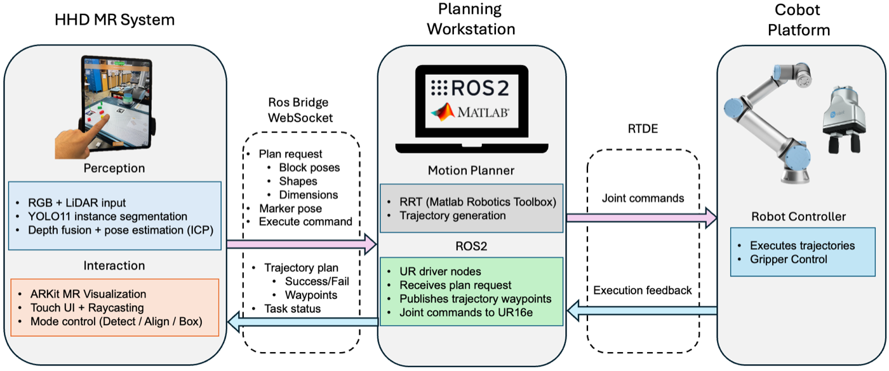
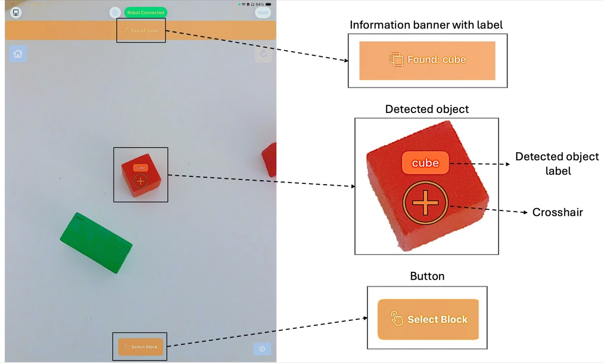
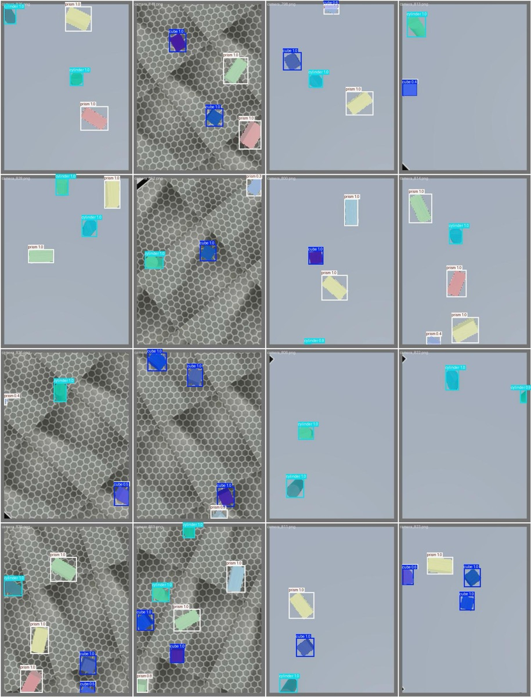

* Built a ROS 2 / MATLAB motion planning and control framework for a UR16e manipulator, driven by object poses from an AI-based perception pipeline running on the handheld device.
* Trained a YOLO11n-seg instance segmentation model entirely on synthetic data and deployed it on-device with Core ML; fused its masks with LiDAR depth for PCA + ICP pose estimation.
* Developed a handheld mixed-reality interface (Swift, ARKit) letting an operator command the robot egocentrically through virtual object manipulation, with spatially registered goals visualized and verified in the robot's workspace.

Video
===

<iframe style="position:absolute;inset:0;width:100%;height:100%;border:0;" src="https://www.youtube-nocookie.com/embed/3-uLGmPzwUo" title="A Handheld Mixed-Reality Framework for Egocentric Perception and Human–Robot Collaboration" loading="lazy" allow="accelerometer; autoplay; clipboard-write; encrypted-media; gyroscope; picture-in-picture; web-share" referrerpolicy="strict-origin-when-cross-origin" allowfullscreen></iframe>

System architecture
===

The MR app on an iPad Pro handles perception and interaction. A planning workstation (ROS 2 and MATLAB) computes collision-free trajectories with RRT, sends them back to the app for the operator to preview and confirm, and then commands the UR16e cobot over RTDE.

AI perception pipeline
===

**Model and data.** I trained a YOLO11n-seg instance segmentation model (Ultralytics) to recognize the task objects: cubes, cuboids (rectangular prisms), and cylinders. The model was trained entirely on **synthetic data**: 5,000 images generated with the Unity Perception package from 12 virtual blocks (3 shapes × 4 colors), with randomized textures, object poses, camera viewpoints, and lighting. The dataset was exported in SOLO format, converted to COCO, and split 60/20/20 into training, validation, and test sets. Training ran for 60 epochs on an NVIDIA V100 GPU (NYU HPC).

**On-device inference.** The trained model was exported to Core ML and runs **directly on the iPad** through the Ultralytics YOLO Swift package, so no server or network round-trip is needed. Inference runs on a background thread to keep the interface responsive; in the stacking tasks, it averaged about 300 ms per detection, which suits the deliberate pace of pick-and-place.

**From masks to robot goals.** Each segmentation mask is resized to the LiDAR depth map, cleaned with morphological opening, and unprojected into a 3D point cloud. Principal component analysis gives an initial position and yaw estimate, which iterative closest point (ICP) registration against the object's mesh then refines. The result is a virtual twin anchored on the physical block, which the operator can confirm or adjust before sending pick and place poses to the robot.

**Results** (synthetic test set, 3,376 object instances, mask metrics):

| Class | Precision | Recall | mAP@50 | mAP@50–95 |
|---|---|---|---|---|
| Cube | 0.920 | 0.959 | 0.987 | 0.944 |
| Cylinder | 0.999 | 0.980 | 0.994 | 0.920 |
| Cuboid | 0.927 | 0.952 | 0.988 | 0.967 |
| **All** | **0.949** | **0.964** | **0.990** | **0.944** |

Although trained only on synthetic images, the model reliably detected the real wooden blocks in the cobot workspace. The main failure mode was occasional confusion between cubes and cuboids at oblique viewing angles, as expected given their similar geometry.

