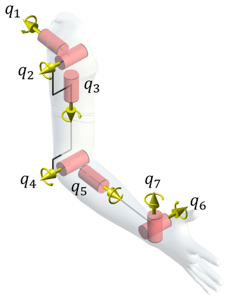
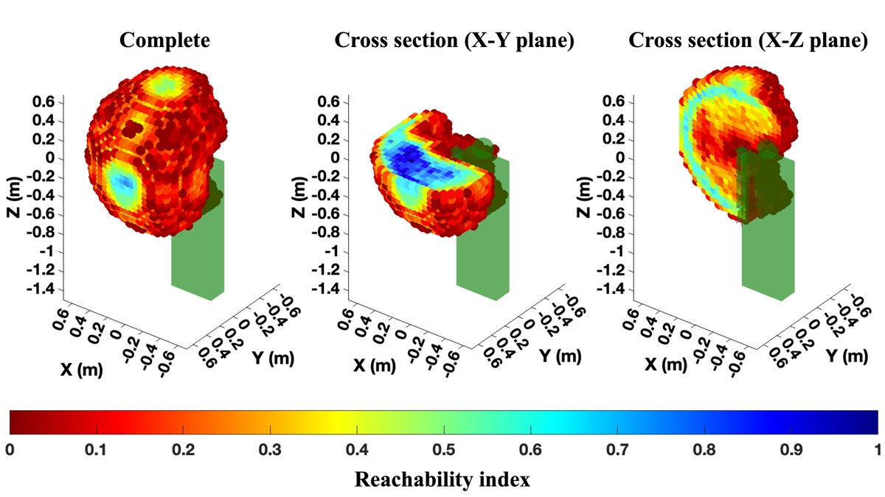
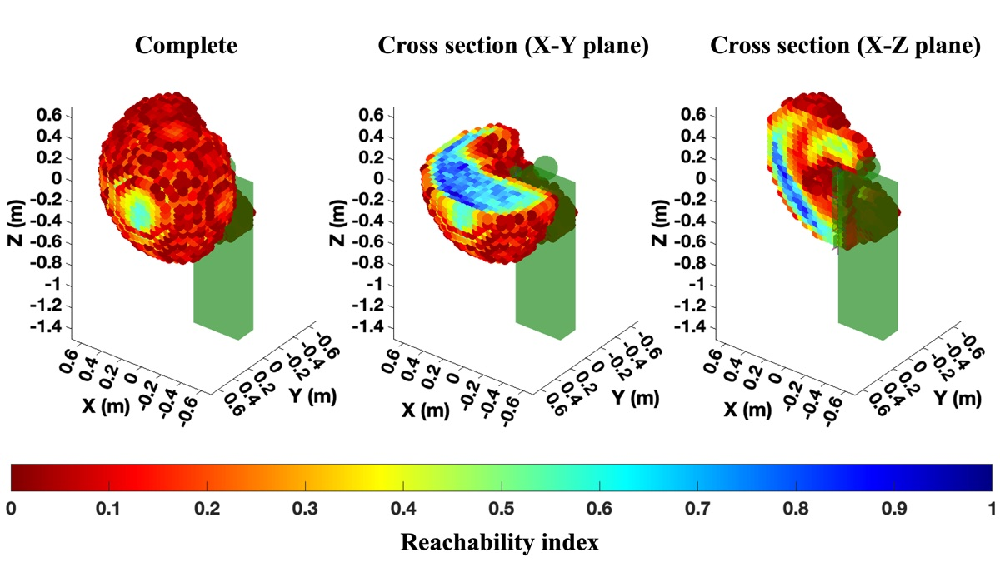
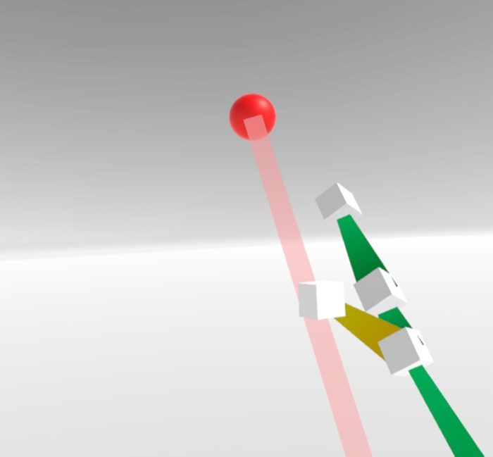
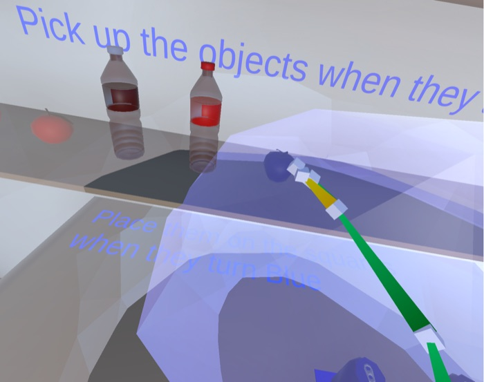

* Built the capability-map pipeline in MATLAB: a 7-DoF human-arm kinematic model as a rigid-body tree with collision meshes, voxelized reachability via forward and inverse kinematics, and per-voxel dexterity scores.
* Ran the system evaluation with four users under simulated shoulder restrictions, quantifying reductions in reachable volume and dexterity and analyzing exergame performance across difficulty levels.
* Team system: Kinect-based range-of-motion measurement and two Unity exergames for an Oculus Quest headset, one for range-of-motion therapy and one for occupational therapy.

**Publication:** [Using Capability Maps Tailored to Arm Range of Motion in VR Exergames for Rehabilitation](/publication/2024-capability-maps-vr-exergames), IEEE EMBC, 2024.

**My role:** I developed the capability maps and ran the system evaluation. The Kinect measurement and the Unity exergames were team efforts with co-authors Zaid Waghoo, Hassam Khan Wazir, and Nishtha Bhagat; Vikram Kapila supervised the work.

Why?
===

Rehabilitation after a stroke or other neurological condition depends on long, repetitive therapy that patients often find unengaging. VR can turn exercises into games, but most VR systems don't know what a specific user can physically do. This project gives a VR system a model of the user's arm, so it can place tasks where they are reachable, emphasize specific joints, and measure performance objectively.

Capability maps
===

<strong>Arm model.</strong> The arm is modeled with seven degrees of freedom: three at the shoulder (abduction–adduction, flexion–extension, internal–external rotation), elbow flexion–extension, forearm pronation–supination, and two at the wrist. In MATLAB, it is built as a rigid-body tree with collision meshes for the upper arm, forearm, and body, so the maps exclude poses where the arm would collide with itself or the body.

<strong>From reachability to dexterity.</strong> The workspace is discretized into voxels. Forward and inverse kinematics determine which voxels the fingertip can reach, and each reachable voxel is scored by how many different hand orientations are possible there. The result is a capability map: a 3D picture of where a user can reach and how dexterously.

**Personalization.** A Kinect measures the user's limb lengths from a neutral pose and the range of motion of each joint during guided exercises. The system builds two maps: a *nominal* map from published healthy range-of-motion values, and a *restricted* map from the user's measured values. Maps are generated offline and queried by the exergames at run time.

<em>Capability maps for an unrestricted arm (top) and with a shoulder restriction (bottom).</em>

Exergames
===

* **Range-of-motion exergame:** the user pops balloons placed in easy, medium, and hard regions of their capability map, following a guide trajectory from a home position. Balloon placement and trajectory can be chosen to emphasize specific joints.
* **Occupational-therapy exergame:** the user moves objects from a shelf to a table, as in daily-living tasks. Convex hulls computed from the restricted map show the user's reachable workspace and most dexterous region, and objects change color when they are within reach.

Results
===

Four users simulated restricted and partially restricted shoulder mobility with a shoulder brace, compared with their unrestricted condition.

| Compared with unrestricted | Reachable volume | Dexterity |
|---|---|---|
| Partially restricted shoulder | 7.8–11.2% lower | 0.8–5.2% lower |
| Restricted shoulder | 21.2–29.9% lower | 5.3–15.7% lower |

In the range-of-motion exergame (10 balloons per difficulty level and condition), balloon-popping speed generally decreased as difficulty and shoulder restriction increased, with one exception. This shows the system can emphasize and assess the use of a specific joint. Future work includes studying user experience and deriving more clinical metrics from the maps.

Figures adapted from Lourido, Waghoo, Wazir, Bhagat &amp; Kapila, "Using Capability Maps Tailored to Arm Range of Motion in VR Exergames for Rehabilitation," IEEE EMBC 2024, <a href="https://doi.org/10.1109/EMBC53108.2024.10781958">doi:10.1109/EMBC53108.2024.10781958</a>. © 2024 IEEE.

