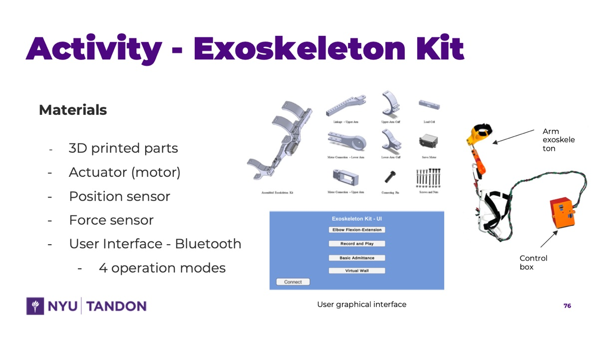

* Designed a professional development methodology that combines social capital theory, cultural-historical activity theory (CHAT), project-based learning, and the 5E instructional model, so engineers can design effective training for non-engineer end users.
* Delivered a weeklong workshop (December 12–16, 2022) to engineering researchers working on the hardware, perception, and control of a wearable exoskeleton.
* Built and programmed the low-cost 3D-printed elbow exoskeleton kits and their Bluetooth control interface (Unity) with four operating modes, and designed the workshop's hands-on example lesson around them.

**Publication:** [A Professional Development Program using a Low-Cost Exoskeleton Kit to Support Trainers in Translating Technical Research to Implementable Recommendations](/publication/2022-asee-exoskeleton-kit), ASEE Annual Conference & Exposition, 2022. The paper presents the program design; the workshop was delivered later that year.

**My role:** first author; I designed the methodology and the workshop program, built and programmed the exoskeleton kits and their control interface, prepared the training materials, and delivered the workshop, with Prof. Hao Su and Prof. Vikram Kapila as co-authors.

Why?
===

Exoskeletons can help people with upper-limb disabilities regain function, but their adoption depends on occupational therapists, who connect the technology with the people who use it. Engineers developing these devices rarely have training in how to teach practitioners about them. This program gives exoskeleton developers the tools to translate their technical research into practical, practice-oriented lessons for occupational therapists.

The exoskeleton kit
===

Each kit combines 3D-printed links and cuffs, a servo motor, a position sensor, and a load cell, with a control interface connected over Bluetooth. Four operating modes illustrate how exoskeletons assist movement:

* **Elbow flexion–extension:** moves back and forth between two commanded angles.
* **Record and play:** records a real human arm movement and replays it.
* **Admittance control:** measures the interaction force between the arm and the exoskeleton and moves accordingly; a gain sets how much force the user needs to apply.
* **Virtual wall:** admittance control with a user-defined angular limit.

The kit is didactic, not a medical device: it lets participants experience the trade-offs that developers face, such as tuning parameters for comfort and responsiveness.

The workshop
===

| Day | Activity |
|---|---|
| 1 | Occupational therapy as a profession; social and educational theories; hands-on example lesson with the exoskeleton kit |
| 2–3 | In small groups, participants design instructional materials to train occupational therapists on their part of the exoskeleton (hardware, perception, or control) |
| 4 | Peer and instructor feedback; participants refine their lessons |
| 5 | Final lessons presented to the project's principal investigators |

In the example lesson, participants take the role of occupational therapists: they assemble and fit the kit on a teammate, tune each operating mode, and discuss how each mode could help a person with an upper-limb impairment. The lesson follows the 5E model (engage, explore, explain, elaborate, evaluate).

**Outcome.** Participants produced lessons that translate the technical aspects of their exoskeleton work into material for occupational therapists, and the workshop materials (theory, lesson examples, and templates) were prepared for reuse in future training.
