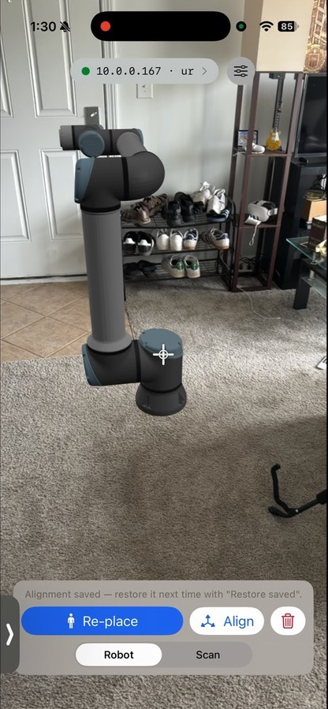
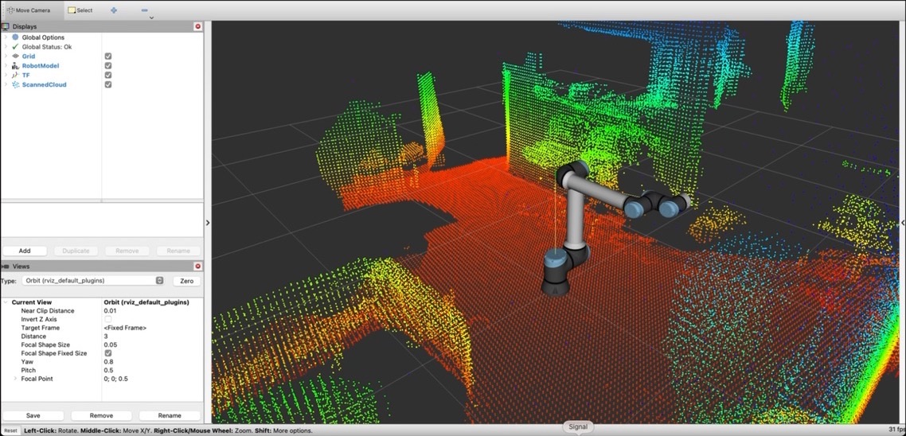

* Built an iOS app (Swift 6, SwiftUI, RealityKit, ARKit) that joins a ROS 2 network over rosbridge, builds the robot from its URDF, animates it from `/joint_states`, and aligns it with the real robot in AR.
* Turned the device's LiDAR into an environment sensor: scans are uploaded to a companion ROS 2 node and published in the robot's `base_link` as a point cloud (MoveIt octomap) and/or a triangle mesh (MoveIt collision object), with the robot itself filtered out automatically.
* Engineered it as an open-source, tested project: 11 Swift packages with unit tests, a Python ROS 2 node, and CI across ROS 2 Humble, Jazzy and Lyrical.

**Code:** [github.com/louridoc/MRRos](https://github.com/louridoc/MRRos) (MIT license) · Personal project, 2026

Video
===

<div style="position:relative;width:100%;max-width:720px;aspect-ratio:16/9;margin:0 auto;">
<iframe style="position:absolute;inset:0;width:100%;height:100%;border:0;" src="https://www.youtube-nocookie.com/embed/47573GTEQGc" title="MRRos: iPhone LiDAR AR app for ROS 2 – align the robot, scan the room into MoveIt" loading="lazy" allow="accelerometer; autoplay; clipboard-write; encrypted-media; gyroscope; picture-in-picture; web-share" referrerpolicy="strict-origin-when-cross-origin" allowfullscreen></iframe>
</div>

Why?
===

A robot's motion planner only avoids what it knows about. Fixed cameras and manual collision models are slow to set up and quickly go out of date when a cell changes. Many phones and tablets already carry a LiDAR sensor. MRRos lets an operator walk around the robot with an iPhone or iPad, see the robot overlaid on the real one, and send an up-to-date scan of the surroundings straight into the planning scene.

How it works
===



1. **Connect.** The app joins the ROS 2 network through rosbridge (WebSocket) and receives `/robot_description` and `/joint_states`.
2. **Place and align.** It builds the robot from the URDF, places it on the floor, and the user aligns it with the real robot along X, Y, Z and yaw. The alignment is saved and can be restored later.
3. **Scan.** The LiDAR scan accumulates as the user walks around. Points that fall on the robot are marked and never uploaded; the scan can be cropped to the workspace, and exclusion boxes remove things that aren't obstacles.
4. **Upload.** The scan goes to the companion node `ar_bridge` over HTTP, already expressed in the robot's `base_link`, as points, a mesh, or both. Scenes can be saved on the phone or in a library on the ROS machine and re-sent later without re-scanning.

<div style="clear:both;"></div>

```
  iPhone / iPad (MRRos app)                       ROS 2 machine
 +----------------------------+  WebSocket :9090  +---------------------------------------+
 | robot in AR, alignment     |<----------------->| rosbridge_server                      |
 | LiDAR scan + filters       |                   | robot_state_publisher, /joint_states  |
 | saved scenes               |   HTTP :8765      | ar_bridge                             |
 |                            |------------------>|  -> /mrros/static_cloud (PointCloud2) |
 +----------------------------+                   |  -> MoveIt collision object (mesh)    |
                                                  |  -> scene library, mesh serving       |
                                                  | MoveIt (optional)                     |
                                                  +---------------------------------------+
```


<p style="text-align:center;"><em>A room scan uploaded from the iPhone (about 150,000 points and 172,000 mesh triangles), shown in RViz around a simulated UR robot.</em></p>

Design highlights
===

* **One frame convention, one place.** ARKit is Y-up; ROS is Z-up. A single alignment module owns the conversion from the AR world to the robot's `base_link`, so every upload arrives in the robot's frame.
* **Any URDF.** FANUC CRX-30iA and CRX-20iA/L and Universal Robots UR10e, UR20 and UR30 ship with bundled meshes; for other robots, `ar_bridge` resolves `package://` meshes on the ROS machine, converts them, and serves them to the app.
* **Split transport.** Small, frequent data (robot description, joint states) goes over rosbridge; bulk binary data (scans up, meshes down) goes over HTTP to `ar_bridge`, which publishes native ROS messages.
* **Distro-agnostic.** The app doesn't depend on the ROS 2 distribution; the ROS packages are tested in CI on Humble, Jazzy and Lyrical (lint, unit tests, build, and a launch smoke test for every supported robot), and the iOS packages are tested on macOS.
* **Safe by design.** The app never commands the robot; it only reads robot state and sends scene data.

Status
===

Research prototype, developed and tested on macOS with ROS 2 Jazzy (RoboStack) and an iPhone with LiDAR, against simulated robots from the included development bringup. Setup instructions for macOS and Ubuntu are in the [repository](https://github.com/louridoc/MRRos).

**Tech stack:** Swift 6, SwiftUI, RealityKit, ARKit (LiDAR scene reconstruction), ROS 2, rosbridge, rclpy, MoveIt 2, RViz, XcodeGen, GitHub Actions.
